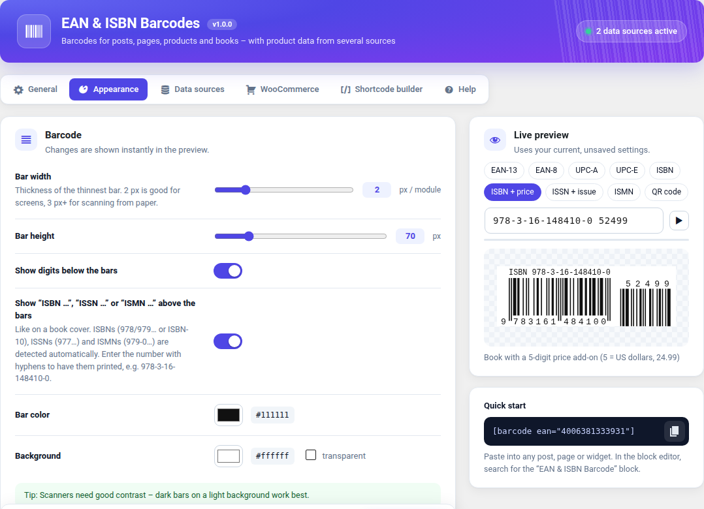
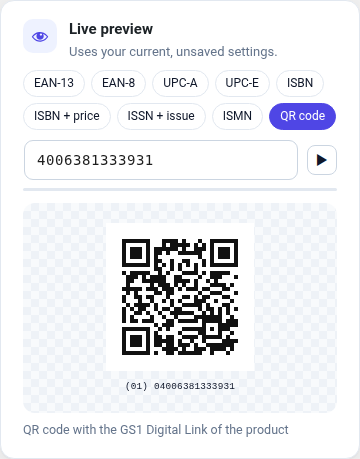

# EAN & ISBN Barcodes

[](https://github.com/Paderman/wp-plugin-ean-isbn-barcodes/releases/latest)


[](LICENSE)

🇬🇧 WordPress plugin for EAN, UPC, ISBN, ISSN and ISMN barcodes and GS1 Digital Link QR codes – as block or shortcode, with product names and product cards from several data sources.

🇩🇪 *WordPress-Plugin für EAN-, UPC-, ISBN-, ISSN- und ISMN-Barcodes sowie QR-Codes mit GS1 Digital Link – als Block oder Shortcode, mit Produktnamen und Produktkarten aus mehreren Datenquellen.* → [Deutsch](#-deutsch)



## Features

- **Sharp SVG barcodes, generated locally** – no account or API needed.
- **Formats:** EAN-13, EAN-8, UPC-A, UPC-E, ISBN (books), ISSN (periodicals), ISMN (sheet music), each optionally with a 2- or 5-digit add-on (issue number, price). ISBN-10 is converted automatically, book barcodes get the classic “ISBN …” line.
- **Check digit validation** with helpful hints for editors.
- **QR codes with the GS1 Digital Link** (e.g. `https://id.gs1.org/01/04006381333931`), optionally with batch and serial number – phones open the product page, 2D-capable checkout scanners read the GTIN. Optional resolver on your own domain that forwards `/01/{GTIN}` to the WooCommerce product.
- **Product data from several sources**, asked one after another: Open Library (books), Open Food Facts (food), ean-search.org (all products, API token). More sources via the `eanbc_providers` filter.
- **Block** with live preview, **shortcodes** and a **shortcode builder**.
- **WooCommerce** (optional): barcode/QR code on the product page (follows the selected variation), GTIN column in the product list, product data lookup next to the GTIN field. Reads WooCommerce's own GTIN field as well as Germanized, German Market and EAN for WooCommerce.
- **Settings page** with rotating live preview, reset per tab and a free choice of where it sits in the admin menu.
- **Languages:** English, German (incl. Swiss variant), French, Spanish, Italian, Dutch.



## Installation

1. Download `ean-isbn-barcodes-x.y.z.zip` from the [latest release](https://github.com/Paderman/wp-plugin-ean-isbn-barcodes/releases/latest).
   *Please use this file – not GitHub's “Source code” archive, which has the wrong folder name.*
2. WordPress → **Plugins → Add New → Upload Plugin**, choose the ZIP, install and activate.
3. Settings: **EAN & ISBN Barcodes** in the admin menu.

Requirements: WordPress 6.0+, PHP 7.4+. WooCommerce is optional.

## Usage

```text
[barcode 4006381333931]                                   EAN-13 barcode
[isbn 978-3-16-148410-0 addon="52499"]                    book with price add-on
[barcode issn="0317-8471" addon="05"]                     periodical with issue number
[ean_product ean="3017620422003"]                         product card
[ean_name ean="3017620422003"]                            product name as text
[ean_qr ean="4006381333931" batch="L2026-11"]             GS1 Digital Link QR code
```

In the block editor, search for the **“EAN & ISBN Barcode”** block. All attributes are listed in the **Help** tab of the plugin settings.

## Privacy & external services

Barcodes and QR codes are always generated on your server. Only product names and product cards need external services (Open Library, Open Food Facts, ean-search.org). The requests are made by your server, contain only the product code (and your API token where needed) – never data about visitors – and are cached. Each service can be switched off. Details: [readme.txt](readme.txt), section *External services*.

## Feedback & translations

Bug reports, translation corrections or wishes are welcome – please [open an issue](https://github.com/Paderman/wp-plugin-ean-isbn-barcodes/issues).

The French, Spanish, Italian and Dutch translations are new – corrections by native speakers are very welcome. Translation files: [`languages/`](languages/) (template: `ean-isbn-barcodes.pot`).

## Development

- Coding standards: `phpcs` with [WPCS 3](https://github.com/WordPress/WordPress-Coding-Standards) and PHPCompatibilityWP, rules in `phpcs.xml.dist` (currently 0 errors, 0 warnings). The official [Plugin Check](https://wordpress.org/plugins/plugin-check/) reports no errors.
- Release ZIP: `bin/build-zip.sh` → `dist/ean-isbn-barcodes-<version>.zip` (files listed in `.distignore` are left out).
- Pushing a tag `vX.Y.Z` builds the ZIP and publishes a GitHub release automatically ([workflow](.github/workflows/release.yml)). The tag must match the version in `ean-isbn-barcodes.php` and `readme.txt`.

## License

[GPL-2.0-or-later](LICENSE)

---

## 🇩🇪 Deutsch

**Funktionen:** scharfe SVG-Barcodes, lokal erzeugt (ohne Konto oder API) · EAN-13, EAN-8, UPC-A, UPC-E, ISBN, ISSN, ISMN, jeweils mit 2- oder 5-stelligem Add-on · Prüfziffern-Kontrolle · QR-Codes mit GS1 Digital Link (optional mit Charge und Seriennummer, optional mit eigenem Resolver) · Produktdaten aus Open Library, Open Food Facts und ean-search.org · Block, Shortcodes und Shortcode-Builder · WooCommerce-Integration (Produktseite, GTIN-Spalte, Produktdaten abrufen; liest auch Germanized, German Market und EAN for WooCommerce) · Einstellungsseite mit rotierender Live-Vorschau · Sprachen: Englisch, Deutsch (inkl. Schweiz), Französisch, Spanisch, Italienisch, Niederländisch.

**Installation:** Die Datei `ean-isbn-barcodes-x.y.z.zip` aus dem [neuesten Release](https://github.com/Paderman/wp-plugin-ean-isbn-barcodes/releases/latest) herunterladen (nicht das „Source code“-Archiv von GitHub) und unter **Plugins → Installieren → Plugin hochladen** installieren. Voraussetzungen: WordPress 6.0+, PHP 7.4+.

**Datenschutz:** Barcodes entstehen immer auf dem eigenen Server. Nur Produktnamen und Produktkarten fragen externe Dienste ab – über den Server, nur mit dem Produktcode, nie mit Besucherdaten. Jeder Dienst lässt sich abschalten.

**Feedback:** Fehlermeldungen, Übersetzungskorrekturen oder Wünsche sind willkommen – bitte ein [Issue öffnen](https://github.com/Paderman/wp-plugin-ean-isbn-barcodes/issues).
